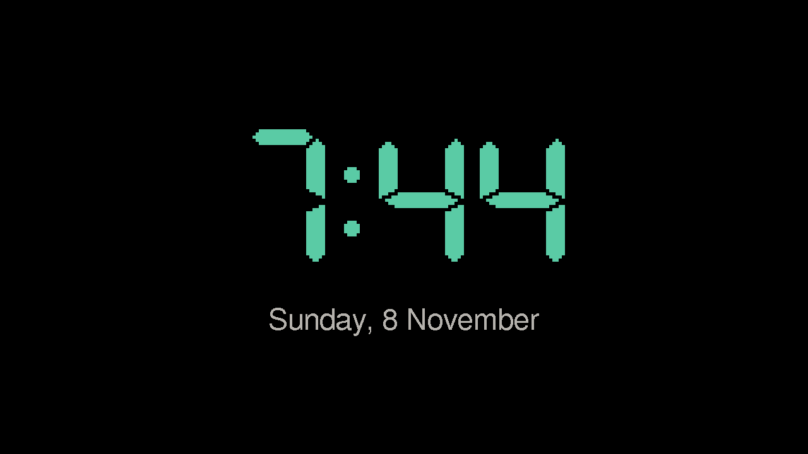

# clock

A desk clock for the [M5Stack Tab5](https://docs.m5stack.com/en/core/Tab5): the time in large green digits and the date under it, on the 1280x720 screen turned sideways. The time comes from the internet, so it shows `--:--` until the Tab5 is online.



It's the first app on the Tab5, and a starting point for what comes next.

## Setup

From this folder:

```sh
cp include/secrets.example.h include/secrets.h   # Wi-Fi and the widgets' keys
pio run -t upload                        # flash the Tab5
pio run -e simulator && .pio/build/simulator/program
```

The time zone is Europe/Bratislava, in `CONFIG` in `src/main.cpp`.

The Tab5's ESP32-P4 needs Arduino 3, from the [pioarduino](https://github.com/pioarduino/platform-espressif32) platform; PlatformIO downloads it on the first build. See `lib/deskkit/boards/tab5.ini`.
