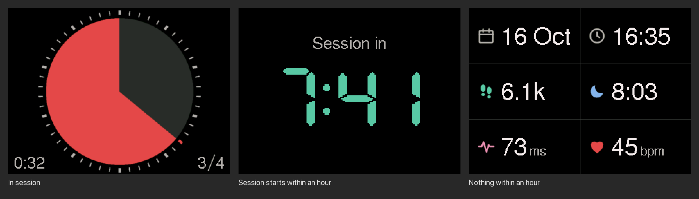

# focusmate-hw

A desk display for [Focusmate](https://www.focusmate.com) sessions on an M5Stack Core2, in the spirit of a Time Timer. It reads your booked sessions from the Focusmate API and shows one of three screens, and between sessions a small health dashboard:



- **In session:** a pie that starts full and empties clockwise a minute at a time, inside a ring with a tick per minute. The tick of the running minute is red. The bottom left corner shows the time left, like 0:15. When several sessions are booked back to back, the bottom right shows which one is running, like 3⁄4.
- **Session starts within 10 minutes:** a countdown.
- **Otherwise:** a dashboard, a grid with the date, the time and today's steps (6.1k), sleep (8:03), HRV and resting heart rate, each marked by an icon instead of a label. The health numbers come from [Moonlite](https://moonlite.im), which syncs them from Garmin.

Tapping the screen moves to the next slide. During a session or its countdown, a tap shows the slides instead; keep tapping to go through them and back to the session, which also comes back by itself 10 seconds after the last tap.

The speaker plays two rising notes one minute before a session and three notes when it starts, and ticks quietly every second while it runs. Two descending notes at the same volume sound one minute before it ends.

## Setup

Install [PlatformIO](https://platformio.org). The commands below run in this folder, `apps/focusmate`. Create your secrets file:

```sh
cp src/secrets.example.h src/secrets.h
```

Fill in your 2.4 GHz Wi-Fi name and password, your Focusmate API key (Focusmate settings page), your Moonlite API token (Moonlite settings page) and your Foodmark weights API token. `src/secrets.h` is ignored by git.

The time zone is set to Europe/Bratislava in `CONFIG` at the top of `src/main.cpp`; change it to your own [POSIX time zone string](https://github.com/nayarsystems/posix_tz_db/blob/master/zones.csv).

Plug in the Core2 and flash it:

```sh
pio run -t upload
```

## How it works

- A background task asks `GET /v1/sessions` for the next 24 hours once a minute. A session you book or cancel shows up within a minute.
- Another task asks Moonlite's `GET /api/v1/stats/today` every 5 minutes for the health numbers. A number Moonlite doesn't have yet shows as `--`.
- A third task asks Foodmark's `GET /external/weights` every 5 minutes for today's weight and the weekly averages. The weight slide shows this week and the seven before as bars of half-kilo segments, green for the lightest week shown to red for the heaviest, with today's weigh-in after this week's average.
- The pie and the countdown run off the device's clock, which is synced from the internet, so they keep going between requests.
- The pie and its ticks are drawn at twice their size into an off-screen canvas in the Core2's PSRAM and shrunk onto the screen, which smooths their edges.
- The dashboard draws straight onto the screen, at full brightness all the time.
- The device has no sleep mode and is meant to stay on USB power.

## Changing the dashboard

`tools/sketch/dashboard.html` is a sketch of the dashboard to open in a browser: the 320x240 screen scaled up, in the device's colors, with fields to try other values. Work out a change there first, then make it in `src/screens/slide_dashboard.cpp`.

The icons live in the sketch as SVGs. After changing one, turn them into the bitmaps the firmware draws:

```sh
uv run --with resvg-py --with pillow python ../../lib/deskkit/tools/icons.py tools/sketch/dashboard.html src/icons.h
```

It renders each icon at 26 pixels and writes its coverage to `src/icons.h`, which the firmware blends onto the screen in the icon's color.

## Screenshots from the device

The `debug` build adds serial commands that put test sessions on screen and send the screen's pixels back, which is how the picture above was made.

```sh
pio run -e debug -t upload
uv run --with pyserial --with pillow python ../../lib/deskkit/tools/screenshot.py p tools/out/pie.png
```

The first argument is a string of commands sent before the capture: `p` pie, `b` pie as the third of four sessions in a row, `q` pie in its last minute, `c` countdown, `d` countdown to the third of four sessions in a row, `w` a session starting in 63 seconds (to hear the chimes), `n` dashboard with a later session, `e` dashboard with nothing booked, `-` capture only. A test session lasts until the next real fetch, at most a minute.

Flash the normal build again when you're done.

## Simulator on a Mac

Without the device, the same firmware runs in a window on the Mac, with real data from the APIs in `src/secrets.h`. A click is a tap, and sound plays through the Mac.

```sh
brew install sdl2
pio run -e simulator && .pio/build/simulator/program
```

The debug commands above work too: type a letter and Enter in the terminal. For a screenshot, give `sim` as the port. The script starts the simulator without a window, takes the picture and closes it:

```sh
uv run --with pyserial --with pillow python ../../lib/deskkit/tools/screenshot.py p tools/out/pie.png sim
```


## Code layout

- `src/`: the app. `main.cpp` picks the screen and plays the sounds, `data/` fetches sessions, health and weight, and `screens/` draws the pie, the countdown and the slides.
- `../../lib/deskkit/`: what isn't about Focusmate, shared with the repo's other apps: devices, the simulator, drawing, fetching and the tools. See [its README](../../lib/deskkit/README.md).

## License

MIT, see [LICENSE](LICENSE).
